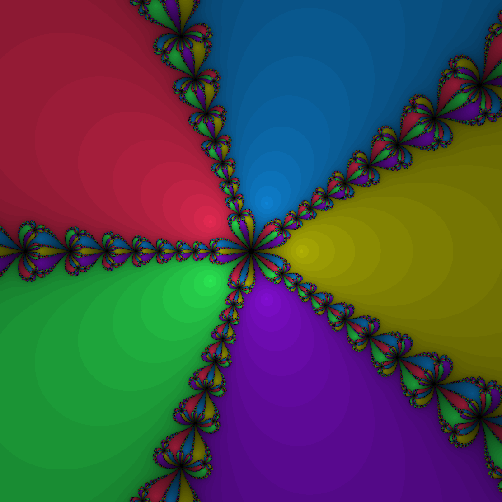

# Fractal

An interactive Newton Fractal visualizer built with C++, OpenGL, and ISPC for high-performance parallel computation.

## Overview

This project visualizes Newton fractals for the equation `z^n - 1 = 0`, where `n` is configurable from 2 to 50. The Newton fractal shows which of the `n` roots each point in the complex plane converges to when using Newton's method for root-finding, colored based on convergence behavior.

The computation is parallelized using **ISPC** (Intel SPMD Program Compiler) for SIMD vectorization, combined with multi-threaded tile-based rendering for maximum performance across CPU cores.

## Preview



## Features

- **Interactive Real-Time Exploration**: Pan and zoom smoothly through the fractal
- **Configurable Exponent**: Choose any `n` from 2 to 50 via command-line
- **High Performance**:
    - ISPC SIMD parallelization
    - Multi-threaded tile-based computation
    - Optimized complex arithmetic and power calculations
- **Screenshot Export**: Save current view as BMP image
- **Cross-Platform**: Works on macOS, Linux, and Windows

## Requirements

- **CMake** 3.10 or higher
- **C++ Compiler** with C++20 support
- **ISPC Compiler** 1.17 or later
- **GLFW3**
- **OpenGL 4.1+**

## Building

### 1. Clone the Repository

```bash
git clone https://github.com/TonyRidley/Fractal
cd Fractal
```

### 2. Install Dependencies

**macOS (Homebrew):**
```bash
brew install cmake glfw3 ispc
```

**Ubuntu/Debian:**
```bash
sudo apt-get install cmake libglfw3-dev libglfw3 glsl-tools
snap install ispc
```

### 3. Build with CMake

```bash
mkdir build
cd build
cmake ..
cmake --build . --config Release
```

The executable will be located at `build/fractal` and in the root directory.

## Usage

### Interactive Window

Run with an exponent to launch the interactive viewer:

```bash
./fractal 5
```

Where `5` is the exponent `n` (try values between 2 and 50).

### Export Image

Save a default fractal image as BMP:

```bash
./fractal 5 --image
```

This generates `fractal_YYYYMMDD_HHMMSS.bmp` with timestamp.

### Help

```bash
./fractal --help
```

## Controls

| Input                 | Action                               |
|-----------------------|--------------------------------------|
| **Left Click + Drag** | Pan around the fractal               |
| **Scroll Wheel**      | Zoom in/out at cursor position       |
| **+ / -**             | Zoom in/out from center              |
| **2 - 9**             | Shortcuts to change power            |
| **R**                 | Reset view to default bounds         |
| **S**                 | Save current view as timestamped BMP |
| **ESC**               | Exit program                         |

## Architecture

### Key Components

- **`fractal.ispc`**: ISPC kernel for Newton's method computation
    - Generic `z^n` power calculation
    - Complex number arithmetic (multiply, divide, absolute value)
    - Newton iteration and color mapping
    - ~27ms per frame at 1111×1111 resolution

- **`FractalRenderer`**: Tile-based multi-threaded computation
    - Splits image into 64×64 tiles
    - Distributes work across all CPU cores via thread pool
    - Synchronizes tile results back to main buffer

- **`FractalWindow`**: Real-time interactive viewer
    - GLFW window management and input handling
    - OpenGL texture upload and rendering
    - Smooth panning with cursor anchoring
    - Scroll-based zoom centered at cursor

- **`FractalImage`**: Batch image export
    - Computes fractal at specified resolution
    - Exports as BMP format

### Performance

On a modern 8-core CPU at 1111×1111 resolution:
- **Computation**: ~20-30ms per frame (ISPC + threading)
- **GPU Upload**: ~0.5-1.4ms
- **Achieves**: 40 FPS with real-time interaction

Performance scales with:
- CPU core count (linear up to 8+ cores)
- CPU thread performance
- Resolution (quadratic)
- Zoom depth (convergence iterations increase)


**"GLFW3 not found"**: Install GLFW development headers
```bash
brew install glfw3  # macOS
sudo apt-get install libglfw3-dev  # Ubuntu
```

**"OpenGL not found"**: Update graphics drivers and ensure OpenGL 4.1+ support

## References

- [Newton Fractal - Wikipedia](https://en.wikipedia.org/wiki/Newton_fractal)
- [ISPC Documentation](https://ispc.github.io/)
- [GLFW Documentation](https://www.glfw.org/documentation.html)
- [OpenGL Tutorial](https://learnopengl.com/)
